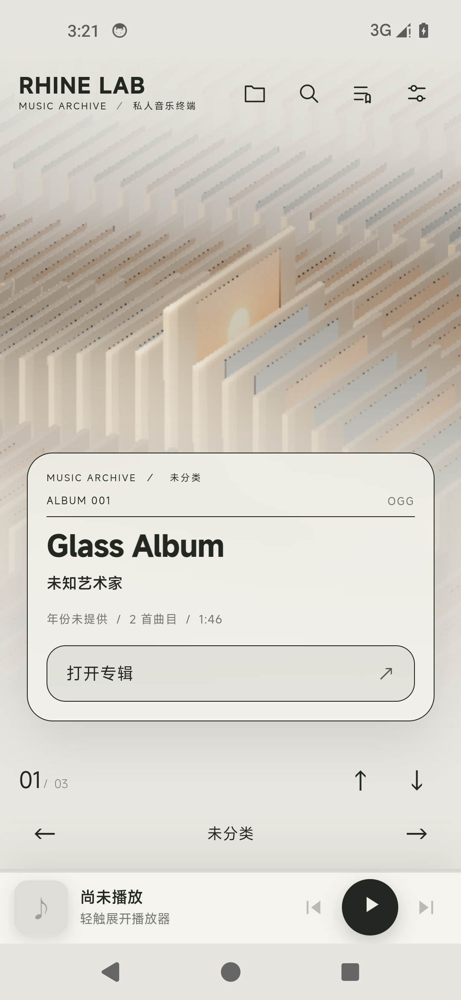
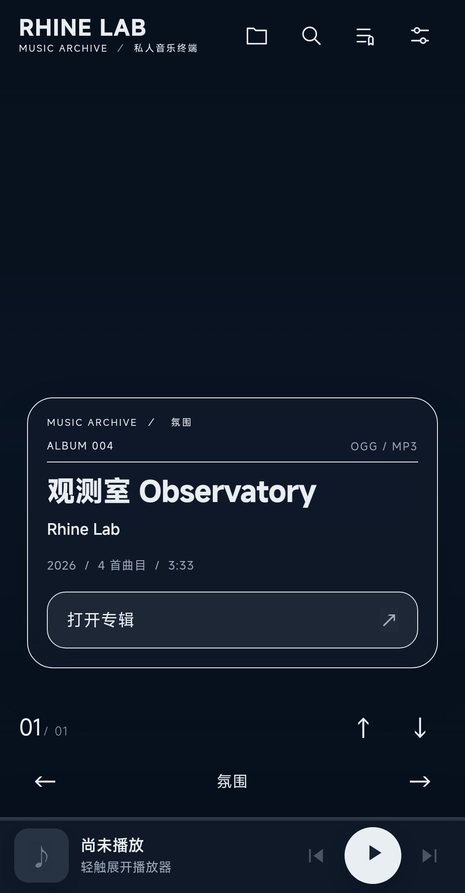
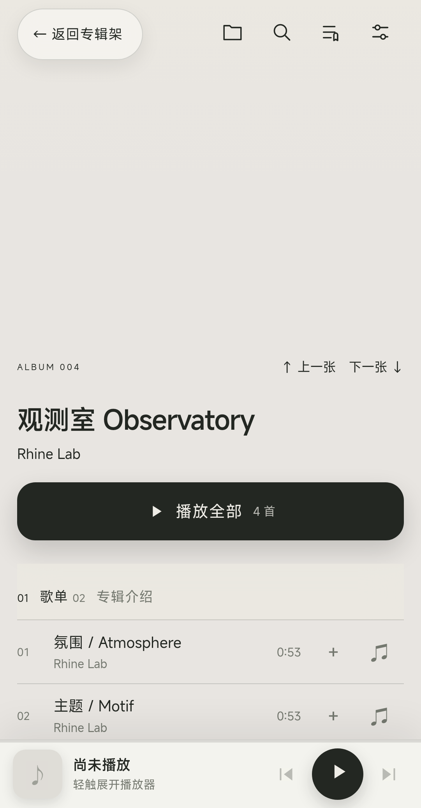
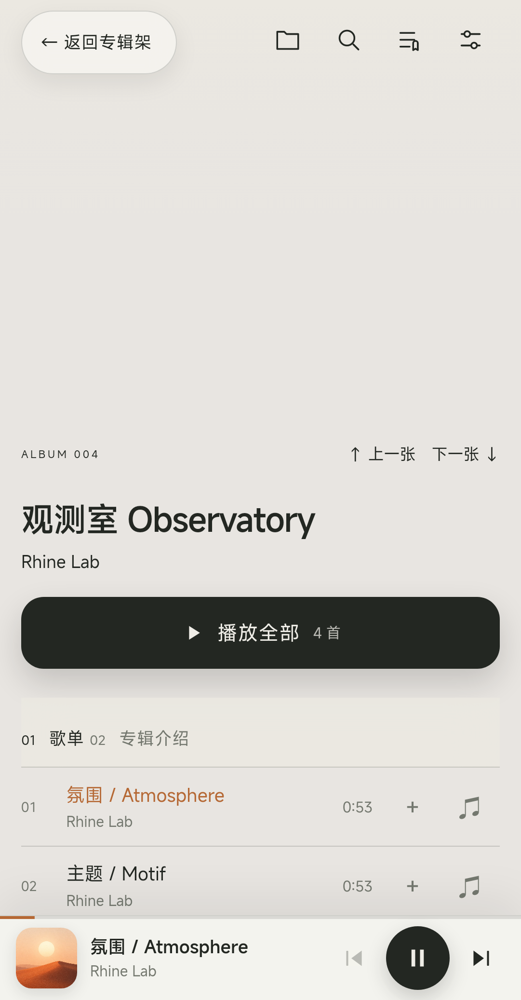
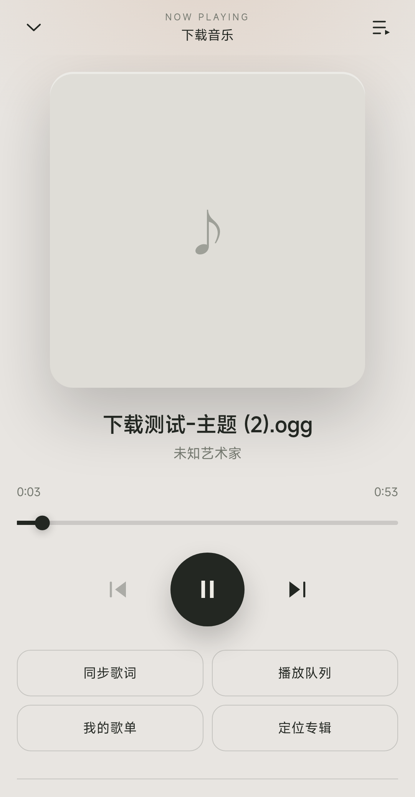
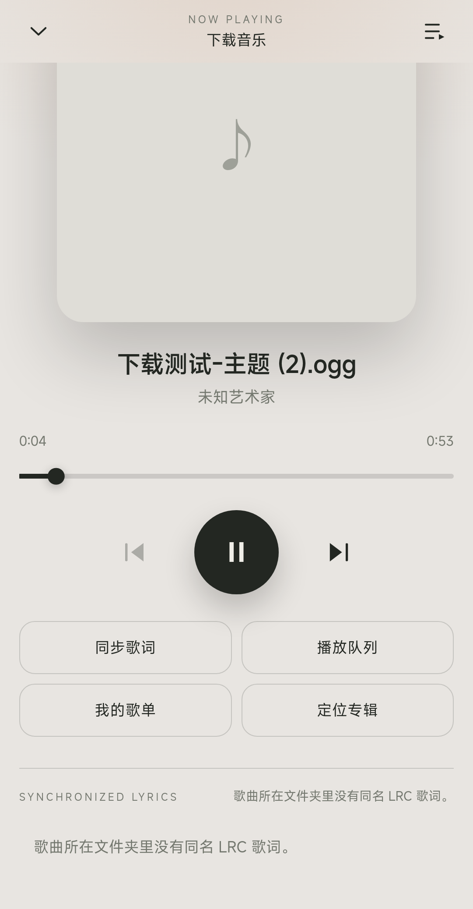
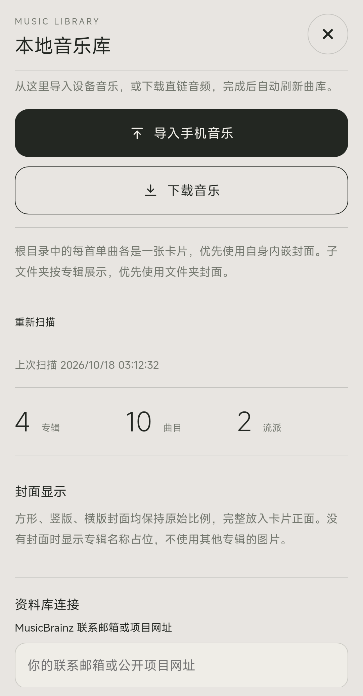
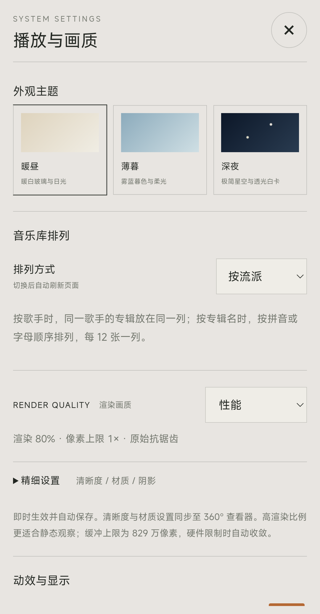

# Rhine Music · 手机版（Android）

把 [Bong712/Rhine-Music-Windows](https://github.com/Bong712/Rhine-Music-Windows) 的三维音乐档案界面搬到 Android 手机上：
WebView 外壳加载同一套 Web 前端，本地 Java 音乐服务提供与原 Windows 版一致的 REST API，并新增**手机竖屏界面**
（底部迷你播放条、全屏正在播放、同步歌词、全屏面板）。

- **安装包**：[`release/Rhine-Music-Mobile-1.0.0.apk`](release/Rhine-Music-Mobile-1.0.0.apk)（约 34.6 MB，自签名，可侧载）
- **包名**：`com.rhine.music` · **版本**：1.0.0（versionCode 1）
- **最低系统**：Android 7.0（API 24）· **目标 API**：34
- **许可**：代码 [MIT](LICENSE)；素材权利见 [NOTICE.md](NOTICE.md)、[NOTICE-ANDROID.md](NOTICE-ANDROID.md)

> 这是个人爱好者工程，与《明日方舟》官方及上游作者无隶属、赞助或授权合作关系。

## 截图

| 专辑架（暖昼） | 专辑架（深夜） | 专辑详情 |
| --- | --- | --- |
|  |  |  |

| 播放中（迷你条） | 正在播放 | 同步歌词 |
| --- | --- | --- |
|  |  |  |

| 音乐库 | 播放与画质 | 队列 |
| --- | --- | --- |
|  |  |  |

## 功能

- **3D 专辑架**：与桌面版同一套 Three.js 场景，竖屏下重新构图，封面卡、标题与导航都在拇指可达区域。
- **播放**：专辑「播放全部」、单曲点播、上一首/下一首、停止、随机与队列；底部迷你播放条常驻，点开全屏「正在播放」可拖动进度。
- **同步歌词**：读取音频同目录同名 `.lrc`，逐行高亮并支持点击跳转；正在播放页内嵌滚动歌词。
- **三种主题**：暖昼 / 薄暮 / 深夜，系统状态栏与导航栏颜色、图标明暗跟随主题。
- **音乐来源**（三种，可同时使用）：
  1. **内置演示专辑**：安装后即有「观测室 Observatory」4 首曲目 + 封面 + 歌词，开箱即可播放；
  2. **导入手机音乐**：系统文件夹选择器（SAF）授权后递归扫描，文件夹封面与同名 `.lrc` 一并导入；也可扫描系统媒体库；
  3. **直链下载**：输入 http(s) 音频直链下载到应用私有目录，完成后自动入库并可播放。
- **歌单**：新建、改名、加曲、排序、移除、删除，持久化在应用私有目录。
- **画质自适应**：手机默认「性能」预设；检测到软件渲染时进一步降级，桌面布局（≥701 px）保持原样不受影响。

## 安装

1. 下载 [`release/Rhine-Music-Mobile-1.0.0.apk`](release/Rhine-Music-Mobile-1.0.0.apk)；
2. 传到手机（数据线 / 聊天工具 / 网盘均可），点击安装；
3. 系统提示「未知来源」时允许该来源安装；
4. 打开「Rhine Music」。首次启动会请求「音乐和音频」读取权限——允许后才会扫描手机里的音乐；拒绝也不影响内置演示专辑。

> 安装包使用本地自签名证书（仅用于侧载）。若从其他渠道安装过同包名应用，需先卸载再安装本包。

## 使用

| 位置 | 操作 | 效果 |
| --- | --- | --- |
| 专辑架 | 左右箭头 / 上下箭头 | 切换流派分类 / 专辑 |
| 专辑架 | 「打开专辑」 | 进入专辑详情（歌单 + 专辑介绍） |
| 专辑详情 | 「播放全部」 | 从第一首开始播放并加入队列 |
| 专辑详情 | 点曲目行 | 播放该曲目 |
| 底部迷你播放条 | 点封面/标题 | 展开全屏「正在播放」 |
| 正在播放 | 拖动进度条 / 点歌词 | 跳转播放位置 |
| 顶栏 | 文件夹图标 | 本地音乐库：导入手机音乐、直链下载、查看来源与重新扫描 |
| 顶栏 | 放大镜 / 歌单 / 顶栏最右 | 搜索 / 歌单 / 播放与画质设置 |
| 任意界面 | 系统返回手势/返回键 | 关闭面板 → 退出「正在播放」 → 返回专辑架 → 退出应用 |

## 构建

前置：Windows 10/11、Node.js 22.12+、JDK 17、Android SDK（build-tools ≥ 34、platform android-34/35）。
详细步骤见 [docs/BUILD.md](docs/BUILD.md)。

```powershell
npm ci
pwsh -File build-web.ps1          # 构建 dist/
pwsh -File android\build.ps1      # 打包并签名 release/Rhine-Music-Mobile-1.0.0.apk
```

Android 侧不需要 Gradle：构建脚本直接调用 `aapt2 → javac → d8 → zipalign → apksigner`，
并把资源以正斜杠路径手工写入 APK（Windows 版 `aapt2` 的 `-A` 参数会写出反斜杠资源名，Android 无法读取）。

## 架构

```
┌───────────────────────────── Android App (com.rhine.music) ─────────────────────────────┐
│  MainActivity (WebView, 竖屏锁定, 系统栏跟随主题, 返回键 → __rhineBack)                    │
│    │                                                                                    │
│    ├── LocalServer  http://127.0.0.1:<port>/   （仅监听回环，Range 流式播放）               │
│    │     ├── 静态资源：APK assets/www （= Web 构建产物 dist/）                              │
│    │     └── 音乐 API：/api/library /api/audio /api/artwork /api/lyrics /api/playlists …  │
│    ├── MusicLibrary  索引：内置演示 / 下载 / SAF 导入 / 系统媒体库（MediaStore）             │
│    └── NativeBridge  JS ↔ 原生：选文件夹、下载、重扫、主题、屏幕常亮、震动、返回            │
└─────────────────────────────────────────────────────────────────────────────────────────┘
```

Web 前端仍是同一套 TypeScript/Three.js 代码：新增 `src/mobile-ui.ts`（手机外壳：迷你播放条、正在播放页、
原生桥调用）与 `src/mobile.css`（≤700 px 的竖屏样式），对 `src/music-app.ts` 仅做挂载级改动；
`src/cover-atlas.ts` 增加 Android WebView 的封面纹理回退路径。接口契约见
[docs/ARCHITECTURE.md](docs/ARCHITECTURE.md)。

## 验证

功能验证在 Android 14（API 34）模拟器 1080×2340 @440dpi 上完成，脚本见 [tools/device/](tools/device/)，
完整记录见 [docs/TEST-REPORT.md](docs/TEST-REPORT.md)：

- 冷启动 → 内置演示专辑入库，封面与歌词可用；
- `/api/audio/<id>` 单段 Range 请求返回 `206` 且 `bytes 0-1023/537407`；
- 点「播放全部」后 `<audio>` 播放中，`currentTime` 前进、歌词逐行高亮；
- SAF 导入文件夹：专辑 2 首 + 文件夹封面 + 同名 `.lrc`；系统媒体库扫描到另一张专辑；
- 直链下载：进度事件 8192 → 674580 → done，完成后自动入库；
- 歌单 CRUD 往返、深/浅色主题切换、返回键层级（面板 → 详情 → 专辑架 → 退出）。

> 模拟器使用宿主 GPU 的 GLES 转译；真机 WebGL 性能通常更好。部分模拟器在封面纹理路径上会打印
> `glCopySubTextureCHROMIUM` 警告，手机版已改为 CPU 像素上传以规避。

## 目录结构

```
android/               原生工程（无 Gradle）
  build.ps1            aapt2/javac/d8/zipalign/apksigner 构建脚本
  app/src/main/java/com/rhine/music/
    MainActivity.java  WebView 外壳、权限、SAF、下载、系统栏、返回键
    LocalServer.java   回环 HTTP 服务（静态资源 + 音乐 API + Range）
    MusicLibrary.java  多来源曲库索引、元数据、封面、歌词、去重
    PlaylistStore.java 歌单持久化
  app/src/main/assets/demo/   内置演示专辑（音频 + 封面 + LRC + manifest）
build-web.ps1          前端构建（tsc + vite + PWA）
src/mobile-ui.ts       手机外壳 UI 与原生桥
src/mobile.css         手机竖屏样式
src/cover-atlas.ts     封面图集（含 Android 回退）
screenshots/           真机截图
release/               构建产物（APK + SHA256）
tools/device/          模拟器/真机自动化验证脚本
docs/                  构建、架构、测试、许可文档
public/、scripts/、content/、sdk/  上游 Windows 版源码与资源（不删改，见 NOTICE）
```

## 已知限制

- 仅竖屏锁定；平板/横屏未做专门适配（不会崩坏，但布局按手机设计）。
- 封面优先使用音频内嵌图或文件夹图片；系统媒体库未授予图片权限，因此媒体库来源只使用内嵌封面。
- 手机版不提供在线资料补充（MusicBrainz）与 foobar2000 连接，设置页中相关入口已隐藏。
- 后台播放依赖 WebView；锁屏/系统省电策略可能暂停播放，属平台行为。

## 许可与致谢

- 代码：[MIT License](LICENSE)，保留上游 LBEILC、RonaldDeng、Bong712 版权声明；手机移植部分版权归本仓库维护者。
- 依赖与素材：[THIRD-PARTY-NOTICES.md](THIRD-PARTY-NOTICES.md)、[NOTICE.md](NOTICE.md)、[NOTICE-ANDROID.md](NOTICE-ANDROID.md)、[docs/LICENSING.md](docs/LICENSING.md)。
- 上游：[RonaldDeng/Rhine-Music-Demo](https://github.com/RonaldDeng/Rhine-Music-Demo)（音乐适配）、[LBEILC/RhineLabUI](https://github.com/LBEILC/RhineLabUI)（三维档案界面基础）、[Bong712/Rhine-Music-Windows](https://github.com/Bong712/Rhine-Music-Windows)（Windows 移植与同步歌词）。

**非代码资源（`.glb` 模型、界面图标、演示封面、MiSans 字体等）不因代码采用 MIT 而自动获得授权。** 详见上述声明文件。
